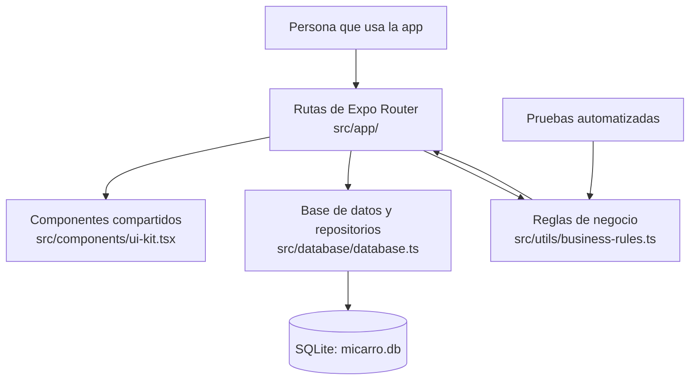

# Guía del proyecto MiCarro

Esta guía explica cómo está organizado MiCarro, dónde vive cada funcionalidad y cómo recorrer el código. El proyecto es una app móvil hecha con React Native, Expo, Expo Router y TypeScript. La información de negocio se guarda localmente con SQLite.

## 1. Cómo se conecta la aplicación



Al abrir la app, `src/app/_layout.tsx` inicializa el esquema de SQLite. Mientras se prepara, muestra un indicador de carga. Cuando termina, presenta las pestañas definidas en `src/components/app-tabs.tsx`.

Las pantallas consultan o guardan datos por medio de funciones en `src/database/database.ts`. Los cálculos compartidos —por ejemplo, el estado de una actividad o el costo total— están en `src/utils/business-rules.ts`, para que las pantallas y las pruebas usen la misma lógica.

## 2. Dónde está cada funcionalidad

| Área visible | Archivo | Qué permite hacer |
|---|---|---|
| Inicio | [`src/app/index.tsx`](../src/app/index.tsx) | Ver vehículos activos, actividades próximas o vencidas y los cinco servicios recientes con costo. Si no hay vehículos, lleva al registro. |
| Vehículos | [`src/app/vehicles.tsx`](../src/app/vehicles.tsx) | Registrar y editar vehículos, consultar la lista, seleccionar el principal y archivar o reactivar. La placa se normaliza para evitar duplicados. |
| Kilometraje | [`src/app/mileage.tsx`](../src/app/mileage.tsx) | Registrar una lectura con fecha, consultar lecturas anteriores y confirmar una lectura inferior a la última. |
| Mantenimiento | [`src/app/maintenance.tsx`](../src/app/maintenance.tsx) | Crear y editar actividades por fecha, kilometraje o ambos; configurar anticipación y periodicidad; pausar y reactivar. |
| Historial | [`src/app/history.tsx`](../src/app/history.tsx) | Registrar servicios preventivos o correctivos, desglosar costos y consultar el historial cronológico. Permite asociar un servicio a una actividad. |

La navegación de estas pantallas está declarada en [`src/components/app-tabs.tsx`](../src/components/app-tabs.tsx). La ruta `explore.tsx` es un ejemplo que viene con la plantilla Expo y queda oculta en la barra de navegación.

## 3. Carpetas y archivos importantes

### Rutas y presentación

- [`src/app/`](../src/app/): las pantallas de Expo Router. El nombre del archivo determina la ruta.
- [`src/components/ui-kit.tsx`](../src/components/ui-kit.tsx): elementos reutilizables de interfaz, como tarjetas, campos, botones, mensajes y contenedor con actualización al volver a enfocar una pantalla.
- `src/components/`, `src/constants/`, `src/hooks/`: componentes, tema y hooks que genera la plantilla Expo. Algunos son soporte de la plantilla y no contienen reglas del negocio de vehículos.
- `assets/`: iconos, imágenes y recursos de Expo.

### Datos y reglas

- [`src/database/database.ts`](../src/database/database.ts): abre `micarro.db`, crea las tablas y concentra las operaciones SQLite para vehículos, lecturas, actividades y servicios.
- [`src/utils/business-rules.ts`](../src/utils/business-rules.ts): calcula estados de mantenimiento, siguientes vencimientos periódicos, suma de costos y validez de fechas.
- [`tests/business-rules.test.ts`](../tests/business-rules.test.ts): pruebas automatizadas de las reglas compartidas.

### Configuración y documentación

- [`package.json`](../package.json): dependencias y comandos disponibles.
- [`app.json`](../app.json): nombre, iconos, navegación y plugins Expo, incluido `expo-sqlite`.
- [`tsconfig.json`](../tsconfig.json): TypeScript estricto y alias `@/` para importar desde `src/`.
- [`eslint.config.js`](../eslint.config.js): reglas de lint basadas en la configuración Expo.
- [`AGENTS.md`](../AGENTS.md): convenciones de trabajo para futuros cambios en el repositorio.
- [`docs/AVANCE.md`](./AVANCE.md): alcance implementado, comprobaciones y pendientes, en formato breve.

## 4. Cómo se guardan los datos

La base local se llama `micarro.db`. Se inicializa al arrancar mediante `initializeDatabase()` en `src/database/database.ts`. El esquema tiene cuatro tablas:

| Tabla | Guarda |
|---|---|
| `vehicles` | Placa, tipo, marca, línea, modelo, año, kilometraje, datos opcionales y banderas de activo/principal. |
| `readings` | Cada lectura del odómetro, su fecha y el vehículo asociado. |
| `activities` | Actividades planeadas, sus vencimientos, márgenes, periodicidad y estado de pausa. |
| `services` | Servicios realizados, fecha, kilometraje, descripción, taller y los tres componentes del costo. |

Las lecturas y los servicios quedan asociados al vehículo por su identificador. Archivar un vehículo cambia su estado a inactivo; no borra sus registros. Registrar o cambiar el kilometraje en el formulario del vehículo también genera una lectura inicial o una lectura nueva, respectivamente.

## 5. Reglas que ejecuta el código

- La placa se guarda en mayúsculas y sin espacios; antes de insertar o editar se comprueba que no pertenezca a otro vehículo.
- El año y el kilometraje del vehículo deben ser enteros no negativos; el año tiene además un límite superior de validación.
- Una lectura inferior al odómetro anterior pide confirmación. Si se confirma, se conserva como otra lectura y se actualiza el odómetro actual.
- Una actividad está vencida si pasó la fecha límite o se alcanzó/superó el kilometraje límite. Se marca próxima cuando cualquiera de los límites entra en el margen configurado.
- Una actividad en pausa se muestra como pausada y se excluye del tablero.
- Los costos de un servicio son mano de obra + repuestos + otros costos. No se aceptan importes negativos.
- La fecha del servicio debe ser válida y no puede ser futura.
- Al vincular un servicio con una actividad periódica, el siguiente vencimiento se calcula usando la fecha y el kilometraje reales del servicio.
- Los cambios de pantalla vuelven a cargar los datos desde SQLite, por lo que el tablero refleja cambios guardados.

Las funciones principales de esas reglas están en `src/utils/business-rules.ts`; los formularios también validan los campos antes de llamar a los repositorios SQLite.

## 6. Instalación, ejecución y comprobaciones

Desde la raíz del proyecto:

```sh
npm install
npm start
```

Escanea el QR con Expo Go compatible con el SDK de este proyecto (SDK 57). Si tienes un emulador Android configurado, puedes usar `npm run android`. Para simulador iOS local se requiere macOS; desde Windows se puede usar un dispositivo compatible con Expo Go.

Comprobaciones disponibles:

```sh
npx expo-doctor
npx tsc --noEmit
npm run lint
npm test
```

`npm test` ejecuta cuatro pruebas de reglas de negocio con el ejecutor de pruebas integrado en Node.js. Comprueban estados por fecha/kilometraje, periodicidad, costos y fechas. No son pruebas de interfaz ni de integración con SQLite.

## 7. Recorrido sugerido para la demostración

1. Abre **Vehículos** y registra un vehículo de prueba. Por ejemplo: placa `ABC123`, tipo `Automóvil`, marca `Toyota`, línea `Corolla`, modelo `XEI`, año `2018` y kilometraje `85000`.
2. Intenta guardarlo otra vez con la placa escrita como `abc 123`. Debe aparecer el aviso de placa duplicada. Edita el vehículo y selecciónalo como principal.
3. Abre **Kilometraje** y registra una lectura superior. Luego intenta una lectura inferior y confirma la advertencia para mostrar el flujo de odómetro.
4. En **Mantenimiento**, crea “Cambio de aceite” para ese vehículo. Configura una fecha próxima, por ejemplo siete días después de la fecha actual, un margen de anticipación de 14 días y una periodicidad de 90 días o 5.000 km. El estado debe ser próximo si está dentro de esos márgenes.
5. En **Historial**, registra el servicio de hoy, con el kilometraje real del servicio, tipo preventivo, descripción y la actividad “Cambio de aceite”. Usa costos de ejemplo: mano de obra 100000, repuestos 250000 y otros 15000. El total visible debe ser 365000.
6. Vuelve a **Mantenimiento** y **Inicio**. Verifica que el siguiente vencimiento se calculó desde el servicio y que el tablero refleja el costo reciente.
7. Cierra y abre la app para revisar que vehículos, lecturas, actividades y servicios sigan guardados.

Los datos de ejemplo se escriben manualmente durante la demostración. La app no inserta vehículos o servicios ficticios automáticamente.

## 8. Alcance y pendientes conocidos

Este avance implementa las cinco áreas descritas en el prompt inicial; no cubre todas las funcionalidades RF-01 a RF-40. Las cuatro pruebas actuales verifican reglas puras, no prueban SQLite. El bundle Android se compiló desde Metro, pero no se hizo una ejecución manual en emulador o dispositivo ni se comprobó la persistencia tras cerrar y reabrir.

La variante web no se verificó: una solicitud de bundle web durante la revisión no pudo resolver el recurso WASM de SQLite. El foco de este avance es móvil. npm reportó 21 vulnerabilidades transitivas durante la instalación (3 moderadas y 18 altas); las dependencias requieren revisión antes de una entrega de producción.
